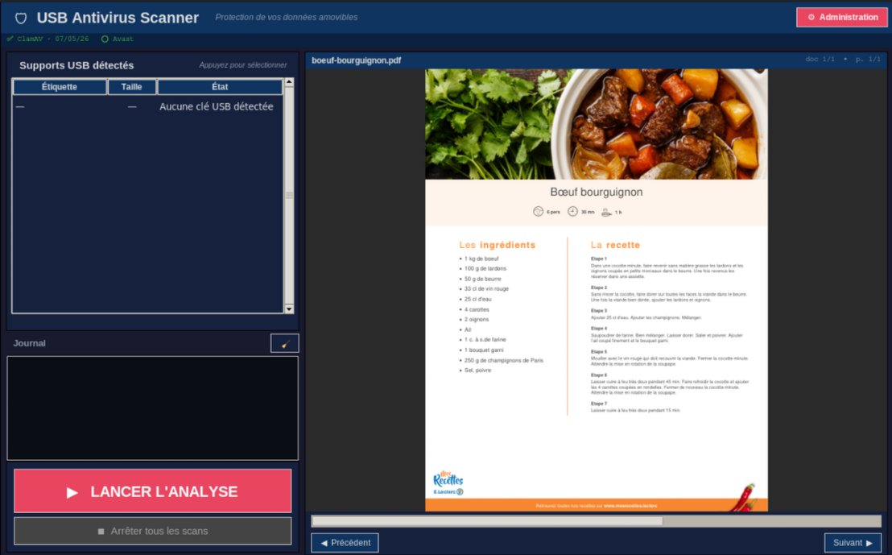

# 🛡 Bastion Antiviral

Station de décontamination antivirale pour supports USB, conçue pour fonctionner en mode kiosque (plein écran, sans interaction clavier nécessaire). L'interface affiche en permanence des documents PDF de sensibilisation ou de communication pendant que l'analyse se déroule en arrière-plan.

---

## Sommaire

- [Aperçu](#aperçu)
- [Arborescence du projet](#arborescence-du-projet)
- [Fonctionnalités](#fonctionnalités)
- [Prérequis](#prérequis)
- [Installation](#installation)
- [Créer l'ISO](#créer-liso)
- [Lancement](#lancement)
- [Interface utilisateur](#interface-utilisateur)
- [Panneau d'administration](#panneau-dadministration)
- [Visionneuse PDF](#visionneuse-pdf)
- [Moteurs antivirus](#moteurs-antivirus)
- [Structure des modules](#structure-des-modules)

---

## Aperçu

Bastion Antiviral est une application Python/Tkinter qui tourne en plein écran sur une station dédiée (ou en mode live depuis un ISO). Elle détecte automatiquement les clés USB branchées, les analyse en parallèle avec plusieurs moteurs antivirus (ClamAV, Avast, YARA), et affiche le résultat dans un journal horodaté. L'accès aux réglages est protégé par un code administrateur.

<div style="display: flex; align-items: center;">
  
</div>

---

## Arborescence du projet

```
.
├── code/
│   ├── admin_auth.py       # Authentification et panneau d'administration
│   ├── config.py           # Chemins et constantes globales
│   ├── db_manager.py       # Mise à jour des bases de signatures
│   ├── gui.py              # Interface graphique principale (Tkinter)
│   ├── log_handler.py      # Journalisation et export PDF des sessions
│   ├── main.py             # Point d'entrée
│   ├── pdf_viewer.py       # Visionneuse PDF cyclique (PyMuPDF)
│   ├── sandbox.py          # Isolation de chaque analyse (bubblewrap + seccomp)
│   ├── sandbox_selftest.py # Vérification du sandbox avec EICAR (sudo)
│   ├── reports.py          # Rapports des supports compromis (locaux) + Evince
│   ├── validated_supports.py # Registre des supports validés
│   ├── export_manager.py   # Export sûr vers un support validé
│   ├── userns_exec.py      # Helper : user namespace « identité »
│   ├── landlock_exec.py    # Helper : interdit execve hors /usr (Landlock)
│   ├── scanner.py          # Moteur de scan et résultats
│   ├── yara_worker.py      # Worker YARA exécuté dans le sandbox
│   ├── usb_manager.py      # Détection et montage des partitions USB
│   └── utils.py            # Fonctions utilitaires partagées
├── iso/
│   ├── makefile            # Génération de l'ISO ou démarrage en mode live
│   └── iso-64-bits/
│       └── forgeIso64.sh # Script de construction de l'image 64 bits
├── pdf/
│   └── *.pdf               # Documents affichés en boucle (sensibilisation, communication…)
└── README.md
```

---

## Fonctionnalités

**Analyse USB**
- Détection automatique et en temps réel des clés USB branchées
- Sélection multi-supports : plusieurs clés peuvent être analysées simultanément (scans parallèles par threading)
- Modes de scan : rapide (*quick*) ou complet (*full*)
- Supports **toujours montés en lecture seule** : les fichiers infectés ne sont ni supprimés ni modifiés, rien n'est écrit sur le support
- Rapport conservé **sur la borne uniquement**, et **seulement pour les supports compromis** (voir « Rapports et supports validés »)
- Statistiques cumulées par session (fichiers analysés, menaces détectées, hachages uniques)

**Moteurs antivirus**
- **ClamAV** — moteur open-source, mise à jour via `freshclam` ou depuis une clé USB
- **Avast** — moteur commercial (licence requise), mise à jour de la base VPS
- **YARA** — règles personnalisées, importables depuis GitHub ou une clé USB

**Interface**
- Affichage plein écran, adapté aux bornes en libre-service
- Journal d'activité colorisé en temps réel (info / avertissement / menace / ok)
- Bandeau d'état permanent des moteurs actifs
- Export du journal de session en PDF
- Visionneuse PDF cyclique pour diffusion de contenus de sensibilisation

**Administration (protégée par code)**
- Sélection des moteurs actifs et du mode de scan
- Mise à jour des bases de signatures (en ligne ou depuis USB)
- Planification automatique via crontab (ClamAV, Avast, YARA, signatures tierces)
- Export et purge des journaux
- Analyse système complète (ClamAV, chkrootkit)
- Changement du code administrateur
- Arrêt ou redémarrage propre de la station

---

## Prérequis

| Élément | Version minimale |
|---|---|
| Python | 3.9+ |
| Tkinter | inclus dans Python standard |
| ClamAV | `apt install clamav clamav-daemon` |
| PyMuPDF | `pip install pymupdf` |
| Pillow | `pip install pillow` |
| Avast (optionnel) | paquet `.deb` officiel + licence |
| bubblewrap + python3-seccomp | `apt install bubblewrap python3-seccomp` (isolation des analyses) |
| Evince | `apt install evince` (consultation des rapports, panneau d'administration) |

> L'application **doit être lancée avec les droits root** (`sudo`) pour accéder aux périphériques USB et exécuter les commandes système.

---

## Installation

```bash
# 1. Cloner le dépôt
git clone <url-du-depot>
cd usb-antivirus-scanner

# 2. Installer les dépendances Python
pip install pymupdf pillow

# 3. Installer ClamAV et mettre à jour la base virale
sudo apt install clamav clamav-daemon
sudo freshclam

# 4. (Optionnel) Placer vos documents PDF dans le dossier pdf/
cp mes_documents/*.pdf pdf/
```

---

## Créer l'ISO

Le `makefile` situé dans `iso/` permet de construire une image ISO bootable basée sur XFCE 64 bits, intégrant directement l'application. Deux modes sont disponibles :

```bash
cd iso

# Construire l'image ISO d'installation
make iso

# Démarrer directement en mode live (sans installation)
make live
```

Le script `xfce-64-bits/forgeIsoXfce.sh` prend en charge la construction de l'image de base, l'intégration des paquets nécessaires et la configuration du démarrage automatique de l'application.

---

## Lancement

```bash
# Depuis le dossier code/
sudo python3 main.py
```

Au premier démarrage, le code administrateur par défaut est **`0000`**. Il est **fortement conseillé** de le modifier immédiatement depuis le panneau d'administration (onglet 🔑 Sécurité).

---

## Interface utilisateur

L'écran est divisé en deux zones principales :

**Colonne gauche**
- Liste des supports USB détectés avec leur taille et leur état de montage
- Journal d'activité horodaté avec code couleur
- Boutons *Lancer l'analyse* / *Annuler*

**Colonne droite**
- Visionneuse PDF : affiche en boucle les documents du dossier `pdf/`, à raison d'une page toutes les 35 secondes

---

## Panneau d'administration

Accessible via le bouton **⚙ Administration** (en haut à droite) après saisie du code. Le panneau est organisé en onglets :

| Onglet | Contenu |
|---|---|
| 🔧 Moteurs | Activer/désactiver ClamAV, Avast, YARA — mode scan |
| 📡 Supports | Vue exhaustive de tous les supports USB détectés |
| 📑 Rapports | Rapports des supports compromis — ouverture avec Evince — export vers un support validé |
| 🛡 ClamAV | Mise à jour en ligne ou depuis USB — signatures tierces |
| 🔐 Avast | Installation, licence, mise à jour de la base VPS |
| 🔍 YARA | Import de règles depuis GitHub ou depuis une clé USB |
| ⏰ Planification | Configuration des tâches crontab (freshclam, Avast, YARA…) |
| 🖥 Système | Mise à jour APT, analyse ClamAV système, chkrootkit |
| 📋 Journaux | Export vers USB, purge |
| 🔑 Sécurité | Changement du code administrateur |
| ⏻ Arrêt | Démontage propre des USB puis poweroff / reboot |
| 🚪 Quitter | Fermeture propre de l'application |

---

## Visionneuse PDF

Le dossier `pdf/` contient les documents diffusés en boucle sur la partie droite de l'écran. Ces documents sont destinés à la **sensibilisation** (bonnes pratiques informatiques, risques liés aux supports amovibles…) ou à la **communication** interne (affiches, notes d'information…).

- Les fichiers sont triés par ordre alphabétique et parcourus en cycle continu.
- Chaque page est affichée pendant **35 secondes**.
- Tout fichier `.pdf` déposé dans le dossier est automatiquement pris en compte au prochain cycle.
- Dépendances requises : `pymupdf` et `pillow`.

---

## Moteurs antivirus

### ClamAV
Moteur open-source intégré par défaut. La base de signatures est stockée dans `/var/lib/clamav` et peut être mise à jour :
- **En ligne** : via `freshclam`
- **Hors ligne** : depuis un fichier `.cvd` ou `.cld` présent sur une clé USB

### Avast
Moteur commercial optionnel. Nécessite l'installation du paquet Avast pour Linux et une licence valide. La base VPS peut être importée depuis une clé USB en environnement isolé.

### YARA
Moteur de détection par règles personnalisées. Les règles (`.yar` / `.yara`) peuvent être téléchargées depuis le dépôt [signature-base](https://github.com/Neo23x0/signature-base) sur GitHub ou importées manuellement depuis une clé USB.

---

## Sécurité

- L'application requiert les droits `root` pour monter les partitions USB et exécuter les commandes système.
- Le code administrateur est stocké sous forme de condensat SHA-256 dans `/etc/virusscanner/admin.json` (permissions `600`).
- **Isolation des analyses** : voir ci-dessous.
- **Lecture seule stricte** et **rapports locaux** : voir « Rapports et supports validés ».
- La fermeture de la fenêtre principale est elle-même protégée par le code administrateur, rendant l'interface résistante aux manipulations non autorisées en contexte kiosque.

### Isolation des analyses (sandbox)

Les moteurs analysent des fichiers hostiles (parseurs d'archives, PE, PDF…) alors que l'application tourne en `root`. Pour qu'une faille d'un moteur ne compromette pas la station, **chaque moteur est lancé dans un conteneur éphémère** ([bubblewrap](https://github.com/containers/bubblewrap), mêmes primitives noyau que Docker/Podman, sans démon) créé pour l'analyse puis détruit.

| Mesure | Effet |
|---|---|
| namespaces mount / pid / ipc / uts / cgroup / **net** | aucun accès réseau, aucun processus de l'hôte visible |
| racine `tmpfs` vide, puis **lecture seule** ; `/usr`, bases et règles en lecture seule | pas d'accès à `/etc`, `/home`, logs, identifiants admin |
| support analysé monté en **lecture seule**, une seule clé par sandbox | rien n'est modifiable sur la clé, aucune autre clé n'est visible |
| capabilities : **uniquement `CAP_DAC_READ_SEARCH`** | lecture de tous les fichiers de la clé quel que soit leur propriétaire (clé ext4, droits 600) ; aucune écriture possible |
| **seccomp** généré (`python3-seccomp`) | interdit `open_by_handle_at`/`name_to_handle_at` (évasion classique liée à `CAP_DAC_READ_SEARCH`), `ptrace`, `mount`, `bpf`, `io_uring`, `keyctl`, `kexec`, `unshare`/`setns`, userns imbriqués… |
| `no_new_privs`, `--new-session`, env vidé, pas de core dump | pas d'élévation, pas d'injection TIOCSTI |
| **Landlock** (`landlock_exec.py`) : `execve()` interdit hors `/usr`, `/bin`… | rien ne s'exécute depuis la clé analysée ni depuis `/tmp` (bubblewrap ne reporte pas `noexec` dans le sandbox) |
| `/tmp` éphémère borné (`SANDBOX_TMPFS_SIZE_MB`) | pas de persistance, pas de saturation du disque hôte |
| YARA exécuté par `yara_worker.py` | plus aucun parsing de fichier dans le processus du GUI |
| chemins remontés par les moteurs validés (`_accept_path`) | un moteur compromis ne peut pas faire inscrire un chemin hors de la clé dans un rapport ou un hash |

**Deux modes** (`SANDBOX_MODE = "auto"` choisit le premier qui passe l'auto-test, réalisé au démarrage) :
- `idmap` : user namespace « identité » créé par `userns_exec.py` ; les capabilities n'existent que *dans* ce namespace (confinement maximal) ;
- `root` : sans user namespace, pour les noyaux qui les interdisent ; root réel réduit à `CAP_DAC_READ_SEARCH` + seccomp.

**Échec fermé, et jamais de faux « sain »** : si `bwrap` est absent ou si l'auto-test échoue, l'analyse est refusée (`SANDBOX_REQUIRED = True`). Toute analyse refusée, incomplète (fichier illisible, moteur absent ou en erreur) est affichée « ANALYSE INCOMPLÈTE — support NON validé » ; le message « aucune menace » n'apparaît que si tout s'est déroulé sans erreur. Le bandeau en haut de l'interface affiche l'état du sandbox.

**Avast** (`AVAST_SANDBOX_MODE`) : `strict` (défaut) exécute `scan` entièrement dans le sandbox ; s'il tente de joindre son démon, l'erreur est affichée avec la marche à suivre. `daemon` autorise l'accès au socket du démon : l'analyse est alors faite **par le démon, hors sandbox** (signalé dans le journal).

**Vérifier une installation** : `sudo python3 sandbox_selftest.py` analyse un fichier EICAR (lisible et illisible-par-autres) avec chaque moteur installé, *dans* le sandbox, et échoue si une détection manque.

### Rapports et supports validés

**Lecture seule stricte.** Aucun support analysé n'est jamais monté en écriture : plus de suppression des fichiers infectés, plus de PDF écrit sur la clé. Une clé compromise reste exactement dans l'état où elle a été branchée, et un support piégé n'a plus de moyen de faire écrire quoi que ce soit par l'application.

**Rapports (supports compromis uniquement).**
- Un rapport PDF n'est produit que si au moins une menace est détectée ; un support sain ne laisse aucun rapport.
- Il est conservé **uniquement sur la borne** (`/var/lib/virusscanner/reports`, droits 700/600), jamais sur le support analysé.
- Il est consultable **uniquement depuis Administration → Rapports**, avec **Evince**, lancé sans les droits root (compte `scanner`, sur une copie temporaire du PDF supprimée à la fermeture). Evince s'affiche en plein écran sans bouton de fermeture (configuration kiosque) : un bouton flottant **« ✖ Fermer le rapport »** reste au premier plan, utilisable à la souris (`Ctrl+W` fonctionne aussi).
- Le rapport contient l'identité du support (UUID, matériel, n° de série), les moteurs et bases utilisés, l'isolation en vigueur, et la liste des fichiers infectés avec leur SHA-256 (500 détaillés au maximum ; la liste est paginée, les chemins longs ne sont pas tronqués).
- **Répertoire permanent.** Sur une borne **installée sur disque** (entrée « Installer sur le disque (kiosque persistant) »), `/var/lib/virusscanner/reports` est un répertoire réel : les rapports **survivent au redémarrage et à l'extinction**. En **mode live** (`nopersistent`) le système de fichiers est en RAM et rien ne peut être permanent : l'application le détecte (`reports.storage_status()`, d'après `/proc/self/mountinfo`) et l'affiche — onglet Rapports, fenêtre « support compromis », journal — au lieu de le supposer.
- **Le redémarrage est ouvert à tous les utilisateurs**, sans mot de passe et sans condition. En mode live seulement, la confirmation *informe* du nombre de rapports qui seraient perdus (sans jamais bloquer).
- **Gestion depuis Administration → Rapports** : ouvrir (Evince), **exporter un ou plusieurs rapports** vers un support validé (la colonne « Exporté » indique lesquels l'ont été), **supprimer** la sélection, ou **purger tout le répertoire** (confirmation explicite, « Non » par défaut, avec le nombre de rapports non encore exportés). La purge ne suit aucun lien symbolique et ne touche pas les copies déjà exportées sur un support.
- **Bornes** : 1 000 rapports et 200 Mo au plus (`REPORTS_MAX_COUNT`, `REPORTS_MAX_TOTAL_MB`). Au-delà, la rotation supprime d'abord les rapports **déjà exportés**, puis seulement si nécessaire les plus anciens non exportés (journalisé) ; le rapport qui vient d'être écrit n'est jamais supprimé.

**Supports validés.** Un support est enregistré comme *validé* quand son analyse est **complète et saine** : aucune menace, aucune erreur, non interrompue, faite dans le sandbox, avec ClamAV ou Avast (YARA seul ne suffit pas). Un support qui revient compromis perd immédiatement sa validation.

**Export (Administration → Rapports).** Les rapports (et les journaux) ne peuvent être exportés que vers un support **déjà validé**. Depuis le panneau administrateur, sans nouvelle analyse, le support est monté en écriture le temps de la copie (`rw,nosuid,nodev,noexec,sync`, type explicite), puis synchronisé et démonté. C'est le **seul** montage en écriture de l'application. Un support non validé est refusé avec la raison. **Appairage.** Au premier export, l'application dépose sur le support un secret aléatoire (`.bastion_pair`) et ne garde sur la borne que son empreinte SHA-256. Aux exports suivants, le support doit d'abord le présenter, lu via un montage **en lecture seule** avant tout montage en écriture (fichier régulier, 64 caractères hexadécimaux, sans lien suivi ni FIFO). Un nouveau scan sain ne réinitialise pas l'appairage ; seul « Oublier le support » le fait.

La copie est faite avec des descripteurs de répertoire et `O_NOFOLLOW` : un lien symbolique placé sur le support (`Rapports_Bastion -> /etc/…`) ne peut pas rediriger l'écriture vers la borne ; aucun fichier existant n'est écrasé.

**Limites** :
- L'identité d'un support (UUID, n° de série, modèle, taille) est fournie par le support lui-même et peut être imitée. Le **secret d'appairage** corrige cela pour tous les exports sauf le premier : un périphérique qui n'a copié que les identifiants visibles est refusé. Restent possibles : un **clone bloc à bloc** de la clé (il contient le secret) et un faux support présenté **avant** le premier export d'une clé. Un UUID connu avec un matériel différent est refusé.
- Le secret d'appairage est lu sur le support par un montage en lecture seule, avec les mêmes risques que l'analyse elle-même ; seul le montage en **écriture** est conditionné à son succès.
- Pendant l'export, le noyau monte en écriture un système de fichiers qui reste du contenu non fiable (liste blanche de types, options durcies, durée minimale) : c'est un risque accepté et limité à un support déjà validé.
- Une clé vierge doit d'abord être analysée une fois (elle sera validée) avant de pouvoir servir de destination.

### Durcissement du montage des supports

Le noyau hôte analyse lui-même la structure du système de fichiers au montage, avant tout sandbox. Pour réduire cette surface (`usb_manager.py`, `config.py`) :
- **liste blanche** `USB_ALLOWED_FSTYPES` (vfat, exfat, ntfs, ext2/3/4, iso9660, udf) ; tout autre type est refusé, et le type est passé explicitement à `mount -t` (le noyau n'essaie pas d'autres pilotes) ;
- **`nosuid,nodev,noexec`** sur chaque montage *et remontage* (`USB_MOUNT_HARDEN_OPTS`), y compris pour un montage créé par le système, qui est durci ou démonté ;
- **`nosymfollow`** (noyau ≥ 5.10, détecté au démarrage) : le noyau refuse de suivre les liens symboliques de la clé ; sans cela un lien absolu `lien -> /etc/shadow` est suivi par tout code qui tourne en root hors sandbox ;
- **`noload`** sur ext3/ext4 en lecture seule : pas de rejeu du journal (aucune écriture sur un support piégé) ;
- sur l'ISO : pilotes de systèmes de fichiers inutiles **interdits au chargement** (`/etc/modprobe.d/bastion-fs-hardening.conf`) et montage automatique udisks2 par défaut en `ro,nosuid,nodev,noexec`.

### Limites connues

- Les pilotes noyau des systèmes de fichiers autorisés (vfat, exfat, ntfs, ext4, iso9660, udf) restent exposés à un support piégé : la surface est réduite, pas supprimée. Garder le noyau à jour.
- Une faille du noyau lui-même (appels système autorisés, namespaces) reste hors périmètre.
- `noexec` (hôte) et Landlock (sandbox) interdisent d'**exécuter** un fichier de la clé, pas de le **lire** : un interpréteur déjà autorisé (`python3 /cle/x.py`, `sh /cle/x.sh`) peut toujours interpréter un script de la clé. C'est inhérent : l'analyse doit lire les fichiers.
- Sans `python3-seccomp`, le sandbox reste actif mais **dégradé** (signalé « limité » dans le bandeau) : les fichiers d'un autre propriétaire en droits 600 ne sont plus lisibles et sont signalés comme *non analysés*.
- Le filtre seccomp est généré et testé sur x86-64 uniquement.
- Le comportement d'Avast dans le sandbox dépend du produit installé : utiliser `sandbox_selftest.py`.

---

## Licence

TODO